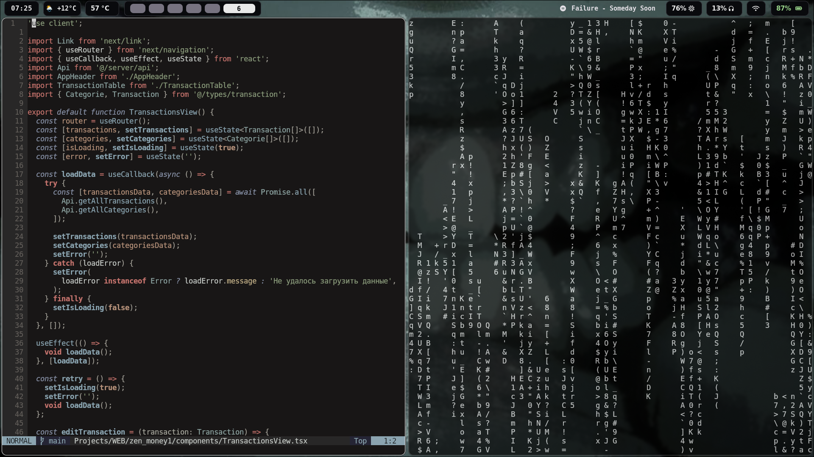

# dotfiles

[](https://archlinux.org)
[](https://hypr.land)
[](https://neovim.io)
[](https://wayland.freedesktop.org)

Мои личные конфиги для **Arch Linux + Hyprland**: оконный менеджер, панель, терминал, Neovim, файловый менеджер и небольшие скрипты для повседневной работы.

Проверено на **Hyprland 0.56.2**, **Neovim 0.12.5**, Wayland. Для Lua-конфига Hyprland нужна версия с его поддержкой (проверено на 0.56.2).



## Что внутри

| Папка          | Описание                                                                 |
| -------------- | ------------------------------------------------------------------------ |
| `hypr/`        | Hyprland (`hyprland.lua`), hyprpaper, hyprlock, hypridle и скрипты       |
| `nvim/`        | Neovim: lazy.nvim, LSP, Telescope, Treesitter, Yazi, темы                |
| `waybar/`      | Панель: погода, Spotify, батарея, звук, сеть + скрипты                   |
| `kitty/`       | Настройки терминала                                                      |
| `rofi/`        | Лаунчер и темы                                                           |
| `yazi/`        | Файловый менеджер и плагины                                              |
| `fastfetch/`   | Красивый вывод информации о системе                                      |
| `all/`         | Разное: `grub`, `tlp.conf`                                               |
| `KEYMAPS.md`   | Подробная шпаргалка по горячим клавишам Neovim и Yazi                    |

## Стек

- **WM:** Hyprland (конфиг на Lua), hyprpaper, hyprlock, hypridle, Hyprspace
- **Панель:** Waybar + swaync
- **Терминал:** kitty
- **Лаунчер:** rofi
- **Редактор:** Neovim + lazy.nvim, kanagawa-dragon, Mason, nvim-cmp, Telescope, Treesitter, conform
- **Файлы:** yazi + набор плагинов (`smart-enter`, `full-border`, `git`, `chmod`, `diff`, `ouch`, `restore`)
- **Мелочи:** cliphist, hyprshot, fastfetch, playerctl, brightnessctl

Для обзора окон (`Super + D` / `Super + Tab`) нужен плагин **Hyprspace**:

## Настройка под себя

| Файл                          | Что менять                                                                 |
| ----------------------------- | -------------------------------------------------------------------------- |
| `hypr/hyprland.lua`           | монитор `eDP-1`, `1920x1080@60`, `mainMod = "SUPER"`, `terminal`, `browser`, раскладка `us,ru`, папка скриншотов |
| `hypr/hyprpaper.conf`         | пути к обоям в `~/Downloads`                                               |
| `hypr/scripts/set-theme.sh`   | обои и темы Waybar (`main`, `dark1`, `dark2`, `teeth`, `win`)              |
| `hypr/scripts/setup.sh`       | приложения, запускаемые при старте (сейчас Firefox и Telegram)             |
| `waybar/config.jsonc`         | город `Minsk`, интерфейс `wlan0`, подсветка `amdgpu_bl1`, датчик `k10temp` |
| `rofi/config.rasi`            | абсолютный путь к теме                                                     |
| `fastfetch/config.jsonc`      | путь к `source` (логотип в `fastfetch/1.txt`)                              |
| `yazi/keymap.toml`            | быстрые переходы `gp` / `gl` в `~/Projects`                                |
| `hypr/hyprlock.conf`          | фон, шрифт и поле ввода экрана блокировки                                  |

## Горячие клавиши

### Hyprland

`mainMod` = `Super`.

| Клавиши                        | Действие                              |
| ------------------------------ | ------------------------------------- |
| `Super + Q`                    | открыть kitty                         |
| `Super + E`                    | открыть yazi                          |
| `Super + B`                    | открыть Firefox                       |
| `Super + R`                    | rofi (запуск приложений и калькулятор)|
| `Super + T`                    | Telegram                              |
| `Super + V`                    | история буфера обмена (cliphist)      |
| `Super + D` / `Super + Tab`    | обзор окон (Hyprspace)                |
| `Super + W`                    | скрыть/показать Waybar                |
| `Super + Shift + B`            | заблокировать экран                   |
| `Super + Shift + S`            | скриншот области (hyprshot)           |
| `Super + C`                    | закрыть окно                          |
| `Super + M`                    | suspend                               |
| `Super + P`                    | плавающий режим                       |
| `Super + G`                    | переключить split                     |
| `Super + F`                    | fullscreen                            |
| `Super + Shift + F`            | maximize                              |
| `Super + H/J/K/L`              | фокус влево/вниз/вверх/вправо         |
| `Super + Shift + H/J/K/L`      | изменение размера окна                |
| `Super + ←/→/↑/↓`              | поменять окна местами                 |
| `Super + 1…0`                  | перейти на рабочий стол               |
| `Super + Shift + 1…0`          | перенести окно на рабочий стол        |
| `Alt + Tab`                    | предыдущий рабочий стол               |
| `Super + колесо мыши`          | листать рабочие столы                 |
| `Super + ЛКМ / ПКМ`            | перетащить / изменить размер окна     |

Мультимедийные клавиши (звук, яркость, play/pause, треки) настроены через `wpctl`, `brightnessctl` и `playerctl`.

### Neovim

`<leader>` = `Space`.

| Клавиши                  | Действие                          |
| ------------------------ | --------------------------------- |
| `jk` (Insert)            | выйти в Normal                    |
| `<C-h/j/k/l>`            | перейти между окнами              |
| `<Space>e`               | Neo-tree                          |
| `<Space>fn` / `fg` / `fb`| файлы / grep / буферы             |
| `<Space>fo`              | недавние файлы                    |
| `<Space>-`               | открыть Yazi                      |
| `<Space>fr`              | форматировать буфер               |
| `gd` / `gD` / `K`        | определение / объявление / справка|
| `<Space>xx`              | Trouble: диагностика              |
| `<Space>u`               | дерево undo                       |
| `<Space>qs` / `ql`       | сессии: выбрать / последняя       |
| `<Space>t`               | новая вкладка                     |
| `gcc` / `gc`             | комментарии                       |
| `sa` / `sd` / `sr`       | окружение (mini.surround)         |

### Yazi

| Клавиши        | Действие                     |
| -------------- | ---------------------------- |
| `Enter` / `l`  | войти в папку / открыть файл |
| `t`            | новая вкладка                |
| `T`            | развернуть превью            |
| `C`            | сжать через ouch             |
| `cm`           | сменить права                |
| `gr`           | восстановить из корзины      |
| `gp` / `gl`    | `~/Projects` / `~/Projects/Labs` |

Больше сочетаний — в [KEYMAPS.md](KEYMAPS.md).

## Скрипты

| Скрипт                          | Назначение                                                  |
| ------------------------------- | ----------------------------------------------------------- |
| `hypr/scripts/setup.sh`         | запуск Firefox и Telegram на рабочих столах при старте      |
| `hypr/scripts/set-theme.sh`     | обои + тема Waybar: `main`, `dark1`, `dark2`, `teeth`, `win`|
| `hypr/scripts/low-battery.sh`   | уведомление при заряде ≤ 15%                                |
| `waybar/scripts/toogle.sh`      | включить/выключить Waybar (`Super + W`)                     |
| `waybar/scripts/get_weather.sh` | погода с wttr.in для указанного города                      |
| `waybar/scripts/mediaplayer.py` | текущий трек Spotify в Waybar                               |

## Структура репозитория

В `.gitignore` используется **whitelist**: игнорируется всё, кроме явно перечисленных папок.

```gitignore
/*
!.gitignore
!/nvim/
!/hypr/
!/waybar/
...
```

Чтобы добавить новую папку в репозиторий, допишите в `.gitignore` строку `!/имя-папки/`. Файлы `README.md` и `KEYMAPS.md` также добавлены в исключения.

Папка `hypr/trash/` — старые версии конфигов (Hyprland, Waybar, fastfetch), их можно удалить.

## Лицензия

Личные конфиги. Копируйте, меняйте и используйте как хотите.
